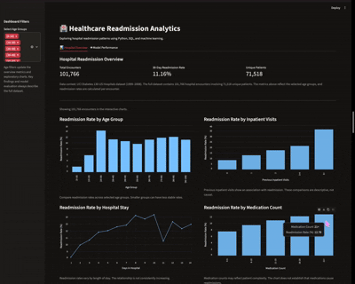

# Healthcare Readmission Analytics & Predictive Modeling

### Python | SQL | Machine Learning | Streamlit

## Project Overview

This project investigates factors associated with 30-day hospital readmissions using the UCI Diabetes 130-US Hospitals dataset (1999–2008).

The analysis includes 101,766 hospital encounters involving 71,518 unique patients.

The goal is to identify patterns in healthcare utilization, evaluate predictive modeling approaches, and communicate findings through an interactive analytics dashboard.

The project demonstrates an end-to-end healthcare analytics workflow, including data cleaning, exploratory data analysis, SQL querying, predictive modeling, and data visualization.

## Business Problem

Hospital readmissions are an important area of investigation for healthcare organizations because they may reflect challenges involving patient complexity, continuity of care, and healthcare utilization.

Understanding patterns associated with readmissions can help researchers and healthcare analysts identify opportunities for further investigation.

This project explores three questions:

1. Which patient and hospitalization characteristics are associated with 30-day readmissions?
2. How does previous inpatient utilization relate to readmission rates?
3. How effectively can a machine learning model identify encounters associated with readmission?

## Dataset

**Source:** UCI Machine Learning Repository — Diabetes 130-US Hospitals (1999–2008)

Dataset link:
https://archive.ics.uci.edu/dataset/296/diabetes+130+us+hospitals+for+years+1999+2008

The dataset contains historical hospital encounters involving patients with diabetes.

### Dataset Summary

| Metric | Value |
|---|---:|
| Hospital Encounters | 101,766 |
| Unique Patients | 71,518 |
| 30-Day Readmission Rate | 11.16% |
| Readmissions Within 30 Days | 11,357 |
| Cleaned Dataset Columns | 52 |

The analysis uses an encounter-level binary outcome indicating whether a readmission occurred within 30 days.

The dataset is historical and should not be assumed to represent current healthcare populations or practices.

## Tools & Technologies

- **Python:** Data processing and analysis
- **Pandas & NumPy:** Data cleaning and manipulation
- **Matplotlib & Seaborn:** Exploratory visualization
- **SQL & SQLite:** Database querying and analysis
- **Scikit-learn:** Predictive modeling and evaluation
- **Streamlit & Altair:** Interactive dashboard
- **Jupyter Notebook:** Documented analytical workflow
- **Git & GitHub:** Version control and project documentation

## Project Workflow

### 1. Data Cleaning

Notebook: `01_data_cleaning.ipynb`

Prepared the hospital encounter dataset for analysis.

Key activities included:

- Inspecting missing values and data types
- Reviewing categorical variables
- Preparing the 30-day readmission target
- Preserving patient identifiers for patient-level analysis
- Exporting the cleaned dataset for subsequent analysis

### 2. Exploratory Data Analysis

Notebook: `02_exploratory_analysis.ipynb`

Investigated readmission patterns across:

- Patient age groups
- Previous inpatient visits
- Hospital length of stay
- Medication counts
- Other hospitalization characteristics

The analysis focused on interpreting readmission rates and identifying patterns that warranted further investigation.

### 3. SQL Analysis

Folder: `sql/`

Used SQLite to explore hospital encounter data and perform grouped analyses.

The SQL workflow examines:

- Overall readmission patterns
- Healthcare utilization characteristics
- Readmission rates across patient groups
- Combinations of previous inpatient visits and hospital stay duration
- Relationships between age groups and previous inpatient utilization

Detailed findings are documented in `ANALYSIS_FINDINGS.md`.

### 4. Predictive Modeling

Notebook: `03_predictive_modeling.ipynb`

Developed Logistic Regression models to predict readmissions within 30 days.

The workflow included:

- Selecting demographic, utilization, and hospitalization features
- Encoding categorical variables
- Scaling numerical features
- Splitting training and test data by patient identifier to prevent patient overlap
- Evaluating class imbalance
- Comparing standard and class-weighted Logistic Regression models
- Assessing predictive performance using multiple classification metrics

## Key Analytical Findings

### Previous Inpatient Utilization

Encounters involving patients with no previous inpatient visits had an 8.44% readmission rate.

For encounters involving patients with five or more previous inpatient visits, the rate increased to 36.41%.

This suggests that previous inpatient utilization is an important characteristic to investigate when examining readmission patterns.

### Age-Related Patterns

The 20–30 age group had the highest observed readmission rate at 14.24%.

However, the 70–80 age group accounted for the largest number of readmissions, with 3,069 encounters.

These findings illustrate the importance of considering both rates and encounter volumes.

### Combined Utilization Patterns

Among encounters involving patients with three or more previous inpatient visits and hospital stays of 4–7 days, the readmission rate was 27.17%.

For encounters involving no previous inpatient visits and stays of 1–3 days, the rate was 7.16%.

These differences are descriptive associations and do not establish causation.

## Predictive Modeling Results

The dataset presented a class imbalance challenge because approximately 11% of encounters involved readmission within 30 days.

The standard Logistic Regression model achieved approximately 89.33% accuracy but only 0.88% recall on the held-out test dataset.

A class-weighted Logistic Regression model improved recall, although precision and overall accuracy decreased.

### Balanced Logistic Regression — Held-Out Test Results

| Metric | Result |
|---|---:|
| Accuracy | 67.43% |
| Precision | 15.73% |
| Recall | 47.09% |
| F1-Score | 0.2359 |
| ROC-AUC | 0.6281 |

The balanced model correctly identified 1,013 of 2,151 actual readmissions but generated 5,426 false positives.

These findings highlight the tradeoff between detecting more readmissions and incorrectly identifying encounters that did not result in readmission.

The model demonstrates modest predictive discrimination and is not suitable for clinical decision-making.

## Interactive Dashboard

The project includes a Streamlit dashboard designed to communicate healthcare utilization patterns and predictive modeling results.

### Dashboard Demo



### Hospital Overview

- Interactive age-group filtering
- Dynamic encounter and readmission metrics
- Readmission rates by age group
- Readmission rates by previous inpatient visits

### Model Performance

- Accuracy, precision, recall, and ROC-AUC
- Prediction outcome visualization
- Model interpretation
- Discussion of limitations

Dashboard screenshots will be added to the repository after final verification.

## Potential Healthcare Applications

### Readmission Risk Research

Explore whether previous hospital utilization can help identify patient groups requiring further assessment.

### Healthcare Resource Planning

Investigate whether utilization patterns could help inform research into discharge support and follow-up services.

### Predictive Analytics

Evaluate additional clinical features, alternative algorithms, and classification thresholds to improve predictive performance.

These applications are exploratory and require further validation before operational or clinical use.

## Limitations

- The dataset covers hospital encounters from 1999–2008.
- The findings are observational and do not establish causation.
- Some patients contribute multiple encounters.
- Differences in subgroup sizes may affect comparisons.
- The target outcome is imbalanced.
- The balanced model produces many false positives.
- External validation, calibration assessment, and fairness evaluation have not been completed.
- The model is not intended for clinical decision-making.

## Project Structure

```text
healthcare_analysis/
├── 01_data_cleaning.ipynb
├── 02_exploratory_analysis.ipynb
├── 03_predictive_modeling.ipynb
├── ANALYSIS_FINDINGS.md
├── dashboard.py
├── requirements.txt
├── README.md
├── sql/
│   ├── 01_readmission_overview.sql
│   ├── 02_...
│   └── 07_age_inpatient_analysis.sql
└── data/
    ├── raw/
    │   └── diabetic_data.csv
    └── processed/
        └── diabetes_cleaned.csv
```

The raw and processed datasets are stored locally and excluded from Git tracking.

## Running the Project

### 1. Clone the Repository

```bash
git clone https://github.com/tapay9/healthcare_analysis.git
cd healthcare_analysis
```

### 2. Create a Virtual Environment

```bash
python3 -m venv .venv
source .venv/bin/activate
```

### 3. Install Dependencies

```bash
python -m pip install -r requirements.txt
```

### 4. Prepare the Dataset

Download the Diabetes 130-US Hospitals dataset from the UCI Machine Learning Repository.

Place `diabetic_data.csv` in:

```text
data/raw/
```

Run `01_data_cleaning.ipynb` to generate the processed dataset.

The dashboard expects:

```text
data/processed/diabetes_cleaned.csv
```

### 5. Launch the Dashboard

```bash
python -m streamlit run dashboard.py
```

The dashboard will open in your browser.

The setup instructions should be verified in a fresh environment before the repository is considered fully reproducible.

## Future Improvements

- Evaluate alternative classification algorithms
- Investigate additional feature engineering
- Explore probability calibration and classification thresholds
- Assess subgroup performance and potential model bias
- Validate findings using more recent healthcare datasets
- Improve dashboard reporting and visualization

## Project Status

- [x] Data Cleaning
- [x] Exploratory Data Analysis
- [x] SQL Analysis
- [x] Predictive Modeling
- [x] Model Evaluation
- [x] Interactive Streamlit Dashboard
- [x] Executive Summary and Analytical Findings
- [x] Interactive Dashboard GIF
- [x] Reproducibility Verification
- [x] Final GitHub Repository Review

## Data Source

UCI Machine Learning Repository: Diabetes 130-US Hospitals (1999–2008)

https://archive.ics.uci.edu/dataset/296/diabetes+130+us+hospitals+for+years+1999+2008

This project is intended for educational and portfolio purposes.
